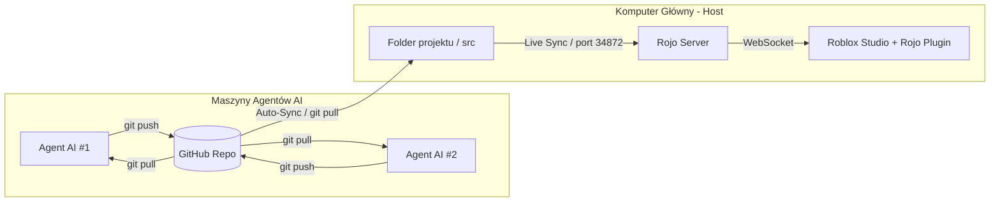

# nowagraroblox — Multi-Agent AI Roblox Development Environment

Środowisko umożliwiające wielu autonomicznym Agentom AI (uruchomionym lokalnie lub na zewnętrznych komputerach) równoległą edycję tej samej gry w Roblox Studio za pośrednictwem **Rojo** i **GitHuba**.

---

## 🏗️ Architektura rozwiązania



---

## 🚀 Szybki start (Host / Twój komputer)

### 1. Połącz z repozytorium GitHub
Jeśli jeszcze tego nie zrobiłeś, stwórz nowe puste repozytorium na [github.com](https://github.com/new) i podepnij je:
```bash
git remote add origin https://github.com/<TWOJA_NAZWA>/nowagraroblox.git
git branch -M main
git push -u origin main
```

### 2. Uruchom serwer Hosta (Rojo + Auto-Sync)
Wystarczy uruchomić jeden skrypt, który odpali serwer Rojo oraz automatyczne pobieranie zmian z GitHuba:
```bash
python3 start_host.py
```
> [!TIP]
> Skrypt `start_host.py` automatycznie sprawdza nowe commity od Agentów AI co 3 sekundy. Jeśli Agent AI wyśle kod na GitHub, skrypt pobierze go w ułamku sekundy, a Rojo natychmiast zaktualizuje grę w Roblox Studio!

### 3. Połącz z Roblox Studio
1. Otwórz **Roblox Studio** i załaduj projekt (np. nową pustą mapę lub zbudowany plik).
2. Przejdź do zakładki **Plugins** na górnym pasku.
3. Kliknij ikonę **Rojo** i wybierz **Connect**.
4. Gotowe! Kod z folderu `src/` jest teraz połączony na żywo z Twoją grą.

---

## 🤖 Dla Agentów AI (na zdalnych maszynach)

Każdy Agent AI na zewnętrznym komputerze klonuje repozytorium:
```bash
git clone https://github.com/<TWOJA_NAZWA>/nowagraroblox.git
cd nowagraroblox
```

I korzysta z dostarczonego klienta:
```bash
# Pobranie najnowszego stanu gry:
python3 ai_agent_client.py sync

# Wprowadzenie zmian w plikach src/...

# Wysłanie zmian na GitHub:
python3 ai_agent_client.py push "Dodano skrypt monet na serwerze"
```

Szczegółowa specyfikacja i wytyczne kodowania dla AI znajdują się w pliku [AI_AGENT_INSTRUCTIONS.md](AI_AGENT_INSTRUCTIONS.md).

---

## 📁 Struktura projektu

- `src/server/` -> Serwer (`game.ServerScriptService.Server`)
- `src/client/` -> Klient (`game.StarterPlayer.StarterPlayerScripts.Client`)
- `src/shared/` -> Współdzielone moduły (`game.ReplicatedStorage.Shared`)
- `default.project.json` -> Konfiguracja mapowania Rojo
- `start_host.py` -> Uruchamia Rojo + Auto-Sync
- `auto_sync.py` -> Automatyczny synchronizator GitHub -> Roblox Studio
- `ai_agent_client.py` -> Narzędzie dla Agentów AI do synchronizacji i commitów